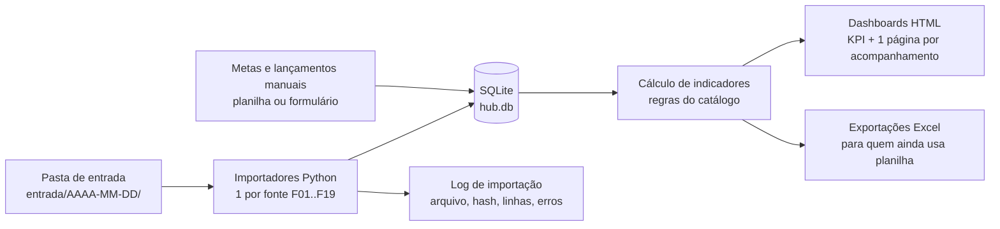

# HubLogistico — Arquitetura

## Estado atual (as-is)
Planilhas Excel por acompanhamento, alimentadas por colagem manual ou macros VBA que procuram arquivos em `Downloads` ou em pastas locais, e ligadas ao KPI por links externos. Mapa completo em [[12_PROJECTS/Active/HubLogistico/MODULES/MOD_00_Mapa_dos_Acompanhamentos|Mapa dos acompanhamentos]].

Pontos frágeis observados:
- Caminhos fixos (`C:\Users\<máquina>\Desktop\...`, `Z:\OPERACIONAL\...`, nome do mês dentro da macro).
- Bases brutas coladas dentro das planilhas (arquivos de até 179 MB por intervalo usado inflado).
- Cadastros (motorista, produto, área) duplicados e mantidos à mão.
- Credencial de banco gravada em conexão de planilha (Roadnet, 2025).

## Proposta (to-be)

| Componente | Responsabilidade | Tecnologia proposta |
|---|---|---|
| Pasta de entrada | onde o usuário solta as exportações do dia | pasta no OneDrive ou na rede |
| Importadores | reconhecer o arquivo pelo conteúdo (não só pelo nome), validar cabeçalho, normalizar unidade/pessoa/produto, gravar | Python 3 |
| Banco | histórico único e rastreável | SQLite |
| Cálculo | indicadores do [[12_PROJECTS/Active/HubLogistico/INDICATORS\|catálogo]] como funções testáveis | Python |
| Dashboards | páginas estáticas (abrem no navegador, sem servidor) | HTML + biblioteca de gráficos |
| Execução | um comando ou duplo clique (`atualizar.bat`); depois, agendado | Windows / Agendador de Tarefas |

> [!tip] Recomendação
> Começar com **páginas HTML estáticas geradas a partir do SQLite**. Não precisam de servidor nem de aprovação de TI, abrem de qualquer pasta e podem ser enviadas por e-mail. Se depois houver necessidade de login, filtros pesados ou vários usuários editando, migrar para um app web interno (ex.: FastAPI ou Streamlit) lendo o mesmo banco.

## Segurança e privacidade
- Dados de clientes, motoristas e valores não vão para hospedagem pública. Publicar fora da rede só com controle de acesso.
- Nenhuma credencial em arquivo do Hub ou do vault; conexões diretas a banco (Roadnet, BI) só com credencial do usuário fornecida em tempo de execução.

## Decisões
- Escolha de stack e de onde o Hub roda: pendente (ADR a registrar em `DECISIONS/` após confirmação do usuário).
