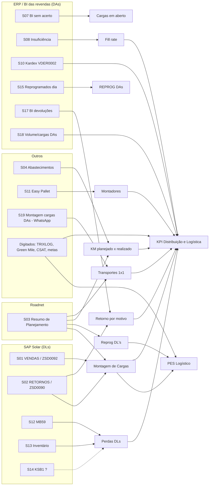

# Mapa de dependências e riscos (nov/2026)

## Fluxo: relatório → planilha → indicador → painel

Linha pontilhada = uso não confirmado. REPROG DAs e Cargas em aberto não alimentam o KPI hoje.

## Riscos priorizados
| # | Risco | Onde | Impacto | Ação proposta |
|---|---|---|---|---|
| R1 | **Link externo para a pasta temporária do WhatsApp** de um usuário. O mesmo padrão aparece no fechamento de Montadores de maio/26 (link para uma "Listagem de Licenças/Afastamentos" recebida pelo WhatsApp) e no 1x1 de setembro/26 (link para um arquivo em `AppData\Local\Temp`) | Transportes 1x1 → KPI; Montadores | alto: quebra quando o WhatsApp limpa a pasta ou em outra máquina | salvar o arquivo de cargas dos DAs numa pasta fixa da rede agora; no Hub, lançar os ajudantes por carga |
| R2 | **Credenciais do Roadnet em texto puro** nas conexões ODBC dos `.xlsm` do Resumo de Planejamento (já no `TASKS.md`; confirmado nas amostras de 23/11) | Montagem, KM, Reprog DL's | alto (segurança) | trocar a senha e usar conexão sem senha salva; fora do Hub |
| R3 | Macro do KM lê de uma pasta local da Área de Trabalho de outra máquina | KM | médio: só funciona naquele PC | o Hub importa direto do Resumo de Planejamento |
| R4 | Arquivos inchados: `CB NORTE - REPROGRAMAÇÃO.xlsx` (37 MB, intervalo até a linha 1.048.576) e `REPROGRAMAÇÃO DIA A DIA.xlsx` com uma aba por dia (~80 abas) | REPROG | médio: lentidão, risco de corromper | limpar o intervalo usado agora; no Hub, uma tabela diária |
| R5 | KPI em uso chama "Outubro - Copia" mas aponta para Novembro; cada link em 3 variantes de caminho | KPI | médio: confusão de versão, links quebram ao trocar o mês | nome único por mês; no Hub, sem links |
| R6 | Arquivo de metas com link para um OneDrive pessoal | Montagem | médio | metas na tabela `parametro` do Hub |
| R7 | Export do Easy Pallet sem data nem base; base deduzida pelo sufixo `(n)` do download | Montadores | médio: colar na base errada | renomear ao baixar (`S11 EASY <BASE> AAAA-MM-DD`) ou o Hub pergunta a base na importação |
| R8 | De-paras duplicados: motoristas (KM `Planilha1`, 1x1 `Planilha1`), montadores (`DA`/`DL`), produtos (Perdas `base` × 2, Fill rate `PRODUTOS`), veículos (Imagens Frota `fleet-plates.js`, Listagem, Roadnet) | vários | médio: divergência de grafia → `#N/D` | cadastros únicos no Hub: `pessoa`, `produto`, `veiculo` (já previstos no `DATABASE.md`) |
| R9 | Fator cubos ↔ cx divergente: 1,6 (Montagem), 1,66 (KPI), 1,68 (citado no TASKS) | Montagem, KPI | médio: número diferente para o mesmo indicador | decidir um fator e guardar em `parametro` |
| R10 | Regra de motivos administrativos do retorno diferente entre Norte e Sul (Norte subtrai −328 fixo) | Retorno | médio | regra única documentada |
| R11 | `HOJE()` nas planilhas de Cargas em aberto: arquivo arquivado muda de valor | Cargas em aberto | baixo | Hub grava a data da extração |
| R12 | Base dos DAs no Retorno colada só como valor | Retorno | baixo: número não auditável | importar a base do BI |
| R13 | Rótulo "% FILL RATE" usado para a insuficiência | Fill rate, KPI | baixo: interpretação errada | no Hub, "Insuficiência %" e fill rate = 1 − insuficiência |
| R14 | Cabeçalho do relatório REPROG cortado (`EDUZ. D`, `SCRICAO PRODUTO`): TXT de largura fixa importado com quebras erradas | REPROG | baixo | importar o TXT bruto com parser de largura fixa (como o Kardex) |
