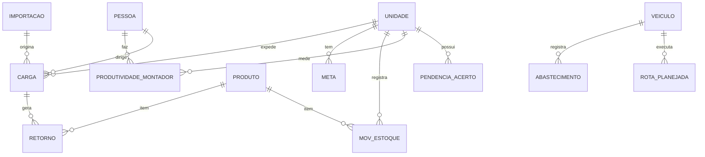

# HubLogistico — Fontes de dados e modelo

## Catálogo de fontes de entrada
"Amostra" indica se já existe um exemplo bruto do arquivo (não só a versão colada dentro da planilha). Nenhuma fonte bruta veio no zip, exceto os TXT e a Consulta BI de 2024.

| ID | Fonte | Sistema | Formato | Frequência | Usada em | Amostra bruta |
|---|---|---|---|---|---|---|
| F01 | VOLUMES DE VENDAS (Barreiras, xlsx) / ZSD0092 (Juazeiro, **.xls BIFF8**) | SAP Solar | xlsx / xls | diária (acumulado do mês) | Montagem, KM (DLs) | **sim** (01–13/11/2026) — importador pronto |
| F02 | VOLUMES DE RETORNOS (Barreiras, xlsx) / ZSD0090 (Juazeiro, .xls) | SAP Solar | xlsx / xls | diária (acumulado do mês) | Montagem, Retorno | **sim** — importador pronto |
| F20 | Resumo de Planejamento - Diário (CBAR_V5 / CCRT) | Roadnet (ODBC) | xlsm, um dia por arquivo | diária | Montagem (D, E, G, I, J), Reprogramação | **sim** — importador pronto |
| F03 | Kardex `VDER0002` | ERP das revendas | TXT largura fixa | mensal | KPI (perdas DAs) | **sim** (2023–2026) |
| F04 | Posição de vendas `VDGR0017` "somente não acertados" | ERP das revendas | TXT largura fixa | mensal | Cargas em aberto | **sim** |
| F05 | Consulta BI — cargas em aberto | BI | xlsx | diária | Cargas em aberto | **sim** (2024) |
| F06 | Base de devolução DAs (Revenda, CodCli, Motorista, Dev Motivo, Dia_Acerto, Saída, Dev) | BI | xlsx | mensal | Retorno | não (só colada) |
| F07 | Listagem de abastecimentos | sistema de abastecimento/frota | xlsx | mensal (acumulado) | KM, consumo | não (só colada) |
| F08 | Rotas planejadas DLs (data em `C8`, rotas da linha 11) | roteirizador | xls/xlsx | diária | KM | não |
| F09 | Rotas planejadas DAs | a confirmar | — | diária | KM | não |
| F10 | Easy Pallet — produtividade por montador | Easy Pallet | xlsx | diária | Montadores | não (só colada) |
| F11 | Fatura Easy Pallet | Easy Pallet | xlsx | mensal | Montadores | sim (ago/2025) |
| F12 | Movimentos de material (perdas) por centro | SAP Solar | xlsx | mensal | Perdas DLs | não (só colada) |
| F13 | Inventário DLs | SAP Solar | xlsx | mensal | Perdas DLs | não |
| F14 | Insuficiência/corte por revenda | BI ou ERP | xlsx | mensal | Fill rate | não |
| F15 | Cadastro de produtos (ERP) | ERP | xlsx | sob demanda | Fill rate, Perdas | sim (colado no Fill rate) |
| F16 | Transportes - 1x1 (ajudantes por carga) | planilha interna | xlsx | mensal | KPI | **não está no zip** |
| F17 | Portais: TRIXLOG, Green Mile, NPS/CSAT, licenças, acidentes | portais Solar/terceiros | manual | mensal | KPI, PES | — |
| F18 | Custos: distribuição, manutenção, pneus, empilhadeiras | financeiro/manutenção | — | mensal | Gestão à vista | **não está no zip** |
| F19 | Fechamentos oficiais Solar (PES) | Solar | xlsx/pdf | mensal | conferência PES | sim |

Cabeçalhos detalhados de F01/F02 em [[12_PROJECTS/Active/HubLogistico/MODULES/MOD_Montagem_de_Cargas|Montagem]]; F03 em [[12_PROJECTS/Active/HubLogistico/MODULES/MOD_Perdas_de_Estoque|Perdas]]; F04/F05 em [[12_PROJECTS/Active/HubLogistico/MODULES/MOD_Cargas_em_Aberto|Cargas em aberto]].

## Modelo proposto

| Tabela | Grão | Chave natural | Fonte |
|---|---|---|---|
| `unidade` | unidade | código (`CBN`, `CBS`, `CBAR`, `CCRT`) + aliases (MATRIZ, FILIAL I/II/III, CB CE Norte…) | cadastro |
| `pessoa` | motorista/montador | login ou crachá; aliases de nome | de-paras atuais |
| `veiculo` | placa | placa normalizada | F07, F01 |
| `produto` | SKU | código Solar ↔ código CB; categoria; fator de conversão | F15, abas `base` |
| `carga` | transporte | (centro, transporte) | F01 |
| `retorno` | item retornado | (centro, transporte, nota, material) | F02, F06 |
| `rota_planejada` | rota/dia | (unidade, data, carga ou placa) | F08, F09 |
| `abastecimento` | abastecimento | (placa, data, km anterior) | F07 |
| `produtividade_montador` | montador/dia | (unidade, login, data) | F10 |
| `mov_estoque` | lançamento | (unidade, documento, seq.) | F03, F12, F13 |
| `pendencia_acerto` | pedido/extração | (revenda, cliente, emissão, data de extração) | F05, F04 |
| `insuficiencia` | produto/dia | (revenda, produto, data) | F14 |
| `meta` | indicador/mês | (unidade, indicador, AAAA-MM) | planilhas de metas |
| `lancamento_manual` | indicador/mês | (unidade, indicador, AAAA-MM) | F17, Custos de descarga |
| `importacao` | arquivo importado | hash do arquivo | log do pipeline |

Regras:
- Toda tabela de fato guarda `importacao_id` (rastreio até o arquivo de origem) e a data de referência.
- Reimportar o mesmo arquivo não duplica (chave natural + hash).
- Nomes de pessoas e clientes ficam só no banco do Hub, nunca no vault.

## SGBD
SQLite (`<dados>/hub.db`). Schema real implementado em `code/hub/db.py` (fase 1): `importacao`, `venda` (PK centro+transporte), `retorno`, `planejamento` (PK centro+data, `origem` = legado < resumo < manual), `planejamento_carga`, `parametro` (centro, mês, chave), `referencia_planilha` (valores das planilhas antigas para conferência). O modelo acima continua sendo o alvo das próximas fases.
