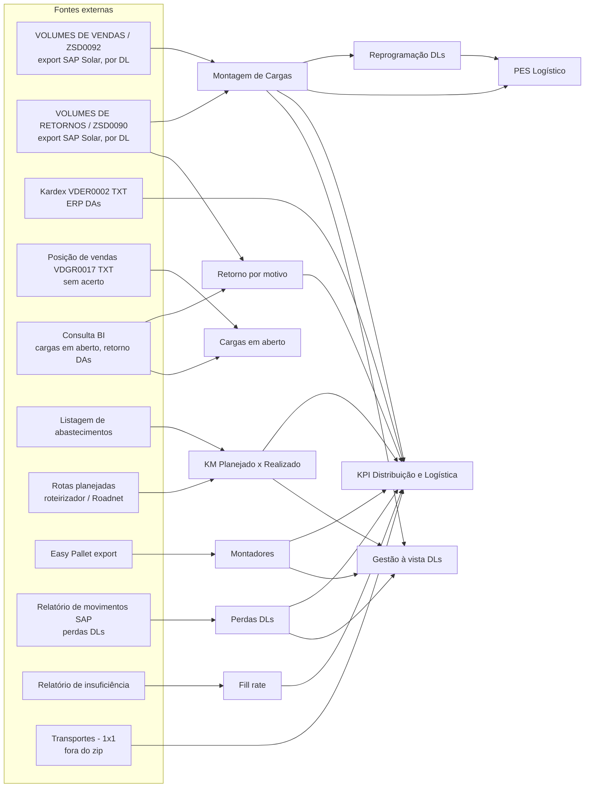

# Mapa dos acompanhamentos

## Inventário do zip (2026-11-16)
| # | Pasta | Arquivos | Período | Frequência | Unidades | Nota |
|---|---|---|---|---|---|---|
| 1 | KPI Distribuição e Logística | 437 | 2023-04 → 2026-10 | diário + fechamento | 4 | [[12_PROJECTS/Active/HubLogistico/MODULES/MOD_KPI_Distribuicao_Logistica\|KPI]] |
| 2 | Analise da quilometragem planejada | 81 | 2024 → 2026-11 | diário + fechamento | 4 | [[12_PROJECTS/Active/HubLogistico/MODULES/MOD_KM_Planejado_x_Realizado\|KM]] |
| 3 | Cargas em aberto | 331 | 2024-02 → 2026-11 | diário (até 2025-02), depois mensal | DAs | [[12_PROJECTS/Active/HubLogistico/MODULES/MOD_Cargas_em_Aberto\|Cargas em aberto]] |
| 4 | Custos de Descarga | 59 | jul–out (DLs) | mensal | DLs | [[12_PROJECTS/Active/HubLogistico/MODULES/MOD_Custos_de_Descarga\|Custos de descarga]] |
| 5 | Fill rate Insuficiencia - CB's Norte e Sul | 24 | 2024-11 → 2026-10 | mensal | DAs | [[12_PROJECTS/Active/HubLogistico/MODULES/MOD_Fill_Rate_Insuficiencia\|Fill rate]] |
| 6 | Gestão à vista | 6 | 2024 → 2026 | mensal (1 arquivo/ano) | DLs | [[12_PROJECTS/Active/HubLogistico/MODULES/MOD_Gestao_a_Vista\|Gestão à vista]] |
| 7 | Montadores | 49 | 2024-01 → 2026-11 | diário + fechamento | 4 | [[12_PROJECTS/Active/HubLogistico/MODULES/MOD_Montadores\|Montadores]] |
| 8 | Montagem de Cargas | 72 | 2023-04 → 2026-11 | diário + fechamento | DLs | [[12_PROJECTS/Active/HubLogistico/MODULES/MOD_Montagem_de_Cargas\|Montagem]] |
| 9 | Perdas de Estoque - DL's | 48 | 2025-01 → 2026-11 | mensal | DLs | [[12_PROJECTS/Active/HubLogistico/MODULES/MOD_Perdas_de_Estoque\|Perdas]] |
| 10 | PES - Resultados comerciais e logisticos | 608 | 2019 → 2026-10 | mensal | 4 | [[12_PROJECTS/Active/HubLogistico/MODULES/MOD_PES_PETS\|PES e PETS]] |
| 11 | Retorno por motivo | 18 | 2025-07 → 2026-10 | mensal | 4 | [[12_PROJECTS/Active/HubLogistico/MODULES/MOD_Retorno_por_Motivo\|Retorno]] |

Tipos: 1.109 `.xlsx`, 48 `.xlsm`, 21 `.xlsb`, 336 PDF, 96 TXT, 74 imagens, 22 zip/rar (cópias compactadas de pastas já presentes), 23 `Thumbs.db`, 4 `.pptx`. Arquivos `~$*.xlsx` são travas do Excel (0 KB, descartáveis).

Padrão de organização: `<Acompanhamento>/<Ano>/<MM - Mês'AA>/arquivo`. O arquivo do mês corrente fica na raiz da pasta do acompanhamento.

## Grafo de dependências (estado atual)

Setas sólidas = link externo, macro ou cópia manual de valor. O KPI de outubro/2026 (cópia) tem links externos para KM, Montadores, Perdas Barreiras, Perdas Juazeiro e Transportes 1x1; os demais valores são digitados.

## Observações gerais
- Cada acompanhamento repete a mesma estrutura por unidade (abas CB NORTE, CB SUL, BARREIRAS/LOG I, JUAZEIRO/LOG II). No Hub isso vira uma coluna `unidade`.
- Cadastros duplicados em várias planilhas: motoristas (apelido → nome completo), produtos (código Solar ↔ código CB, fator de conversão), áreas/rotas e ida-e-volta. Centralizar num cadastro único.
- Datas aparecem como serial do Excel (ex.: 46296 = 2026-10-01).

## Auditoria de nov/2026
Os arquivos atuais (nov/2026) e as amostras dos relatórios-fonte foram conferidos em [[AUDITORIA/README|AUDITORIA]]. Lá estão a matriz de fontes, o checklist do que exportar e as fichas novas de REPROG (DAs), Transportes 1x1 e Imagens Frota.
